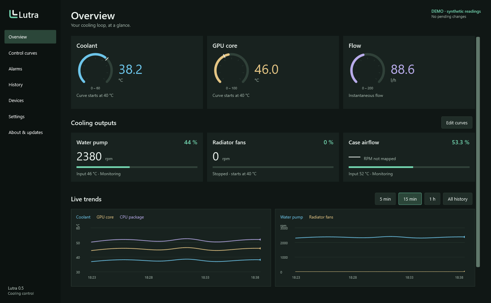

<p align="left"></p>

# Lutra

Cooling control for Windows. Connect a temperature sensor to a fan or pump, shape its response, and keep an eye on the loop.

**Preview software.** QUADRO and motherboard control are implemented, but hardware support is deliberately bounded. See the [compatibility matrix](docs/COMPATIBILITY.md) before handing over cooling.



## What it does

- Dark monitoring overview with temperature and flow gauges, large RPM readings, PWM bars and simultaneous temperature/RPM history.
- Optional lower display limit for each flow meter: readings below its reliable range appear as `< 40 l/h`, for example. Raw readings remain available in Devices and History.
- Independent curves with selectable temperature inputs and output channels.
- QUADRO fan/pump control, including hardware curves, startup temperature, minimum, maximum and fallback duty.
- Motherboard fan headers exposed by LibreHardwareMonitor 0.9.6.
- Drag or numerically edit any of 16 points; straighten a curve between its endpoints.
- Pump minimum duty below its start temperature.
- Optional extra safety temperature per curve.
- Temperature alarms with direction, delay, hysteresis and desktop notifications.
- Local history: 15 minutes, 1 hour, 6 hours, 24 hours, 7 days or 30 days; configurable 1–30 day retention.
- English by default, Finnish selectable immediately.
- A Windows service for control and logging; the monitor can remain in the notification area.
- About page with project links and on-demand GitHub updates, package checksum verification and recovery of the previous installation.

No RGB features. No Aquasuite installation, UI assets or executable code required. This project is independent of Aqua Computer, EK, Noctua and LibreHardwareMonitor.

## Run

Download the Windows x64 ZIP from [Releases](https://github.com/Resnais-Beefhair/lutra/releases), or [build from source](#build). Extract it into a normal folder and run `Lutra.exe`. The **Windows build** workflow also provides packages for development commits.

The application begins in **read-only monitoring** when its service is not installed. `Lutra.exe --demo` opens the complete interface with explicitly labelled synthetic data and cannot write to hardware.

1. Check **Devices** for compatible outputs.
2. For motherboard headers, install the signed [PawnIO driver](https://pawnio.eu/) yourself, then enable motherboard support in **Settings**. Lutra never disables Windows security or installs that driver silently.
3. Stop other applications/services that write the same channels. The installer and controller explicitly detect Aquasuite and Vesi; other tools must also be stopped.
4. In **Settings**, choose **Install Lutra service…** and accept Windows' administrator prompt. The monitor exits while the installer copies files. Reopen Lutra from the Start menu.
5. Add a curve, select its input/output and limits, then **Apply changes**. Read back the resulting RPM and test loss of input before leaving the system unattended.

The installer uses `%ProgramFiles%\Lutra` and `%ProgramData%\Lutra`. It does not disable, uninstall or modify other cooling software. An existing Lutra configuration is preserved on upgrade. Alarms need the monitor running (visible or in the notification area) and Windows notifications enabled for desktop notifications; logging continues in the service. In the installed copy, enable **Settings → Alarm notifications → Start monitor when I sign in** to start quietly in the notification area. Opening Lutra again brings the existing monitor forward.

**Settings → Flow meter display** sets a display-only lower limit per sensor (0 disables it). A below-range indication includes raw zero readings; it cannot distinguish a stopped flow from a flow too small for the sensor to measure. Missing or stale readings still show as unavailable. This preference never changes cooling, sensor calibration, recorded history or alarm evaluation.

From version 0.5, use **About & updates → Check for updates → Install update** to update an installed copy. Preview versions include newer previews by default. Windows requests administrator approval; settings and history are retained. See [update verification and recovery](docs/UPDATES.md).

**Do not assume every motherboard is supported.** Only controls actually exposed by the library are offered. Their physical header mapping and minimum effective speed must be checked on the machine. BIOS control resumes on a normal service exit; a system or driver crash does not guarantee restoration. Configure an appropriate BIOS cooling profile too.

## Curve behavior

The curve's vertical axis is response, scaled to the output's minimum and maximum. A response of 50% with limits 20–100% produces 60% duty. A zero response produces zero duty unless **Hold minimum below start** is enabled.

For a pump that should remain at minimum until 40 °C:
- Mark the output as a pump, enable hold minimum, and set the manufacturer's minimum duty.
- Set the first point to 40 °C / 0% and the start temperature to 40 °C.
- Set the warm endpoint and straighten. RPM is hardware dependent; zero PWM is not a universal pump stop command.

For radiator fans that should start at 40 °C:
- Leave hold minimum off.
- Set a zero-response point just below 40 °C, then a rising curve and start temperature 40 °C.
- Once running, the fans continue until the input falls to the curve's last zero point. This gap prevents rapid on/off cycling.

Coordinate text edits are deliberately separate from the graph until **Update point** or **Straighten** is pressed. Apply is unavailable while a coordinate edit is pending. Removing a QUADRO rule parks that channel at its previous fallback duty; removing a motherboard rule returns that header to firmware control.

## Build

Windows x64 and .NET 8 SDK:

```powershell
.\tools\Build.ps1
.\tools\Build.ps1 -Package
```

The package is self-contained and pins the runtime patch in the build script. The solution has separate Core, Hardware, Service and WPF App projects. Tests never write to hardware. The optional read-only probe is:

```powershell
dotnet run --project tests/Lutra.Tests -c Release -- --probe
```

Probe output includes local device identifiers; review it before sharing. Do not commit your configuration, telemetry, USB traces or serial numbers.

## Development

See [architecture and safety behavior](docs/ARCHITECTURE.md), [protocol notes](docs/PROTOCOL.md), [contributing](CONTRIBUTING.md) and [release validation](docs/VALIDATION.md). The UI system is recorded in [DESIGN.md](DESIGN.md).

Lutra's code and original logo are MIT licensed. Dependencies retain their own licenses; see [third-party notices](THIRD-PARTY-NOTICES.md). The preview executable is unsigned; it does not claim to eliminate every antivirus or SmartScreen warning.

