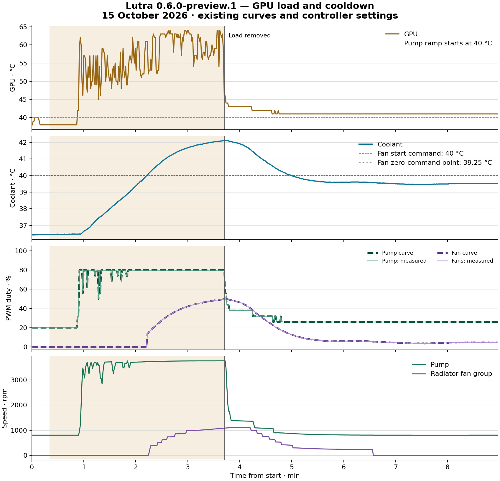

# QUADRO / RTX 4090 physical load test

On 15 October 2026, one installed Lutra **0.6.0-preview.1** system was exercised with real GPU compute load and then observed while cooling down. The pump and radiator fans increased speed according to their configured curves and returned to their quiet physical speeds. The exact final **20% pump / 0% fan commands were not reached** within the observation period.

This is evidence for the particular configuration and operating range below. It is not a full compatibility or unattended-safety certification. See the [compatibility matrix](../COMPATIBILITY.md) and [failure behavior](../ARCHITECTURE.md).

## System under test

| Component | Tested configuration |
| --- | --- |
| Application and service | Lutra 0.6.0-preview.1, commit [`d96e643`](https://github.com/Resnais-Beefhair/lutra/commit/d96e643e3be9198c926ea05a04ac98965b32e414), bundled .NET 10.0.13 |
| OS | Windows 11 Home x64, build 26300 |
| GPU | NVIDIA GeForce RTX 4090, driver 617.42 |
| CPU / motherboard | AMD Ryzen 7 7800X3D / ASRock B650E PG-ITX WiFi; motherboard control disabled |
| Controller | One Aqua Computer QUADRO, firmware 1033, settings structure 3 |
| Pump | EK-Quantum Kinetic TBE 200 D5 PWM D-RGB, connected to QUADRO output 1 |
| Radiator / fans | EK-Quantum Surface P240M; two Noctua NF-A12x25 PWM 120 mm fans on QUADRO output 2 |
| Flow sensor | Aqua Computer high flow 2; configured calibration 147 pulses/litre, correction 0% |
| Coolant temperature input | QUADRO physical temperature input 1; exact temperature-probe wiring was not independently traced |
| Coolant / tubing | DP Ultra; Corsair Hydro X XT Hardline 14 mm PMMA tubing (nominal outside diameter) |

Cooling component models, coolant and tubing were identified by the owner. Controller identity, firmware, input/output mapping and measurements were checked through the running software and controller reports. The observed calibration and duty limits describe this system; they are not universal settings for every loop using these products. One RPM signal was available for the two-fan group; each fan was not independently measured.

## Curves and safeguards retained during the test

| Setting | Pump | Radiator fans |
| --- | --- | --- |
| Temperature input | GPU core, host-fed to QUADRO software slot 0 | Coolant, native QUADRO physical input 1 |
| Output | QUADRO channel 1 | QUADRO channel 2 |
| Minimum / maximum / fallback duty | 20% / 79.83% / 79.98% | 0% / 100% / 100% |
| Hold minimum below start | Enabled | Disabled |
| Start temperature | 40 °C | 40 °C |
| Curve endpoints | 40 °C / 0% response to 50 °C / 100% response | 39.25 °C / 0% response to 45 °C / 100% response |
| Shape | 16 points, straightened between endpoints | 16 points, straightened between endpoints |
| Start boost | Disabled | Disabled |
| Additional safety input | Coolant, 45 °C | None |

Response is scaled between the duty limits; it is not the duty itself. For example, the pump's 50% response at 45 °C means approximately 49.92% duty. The fan start latch is 40 °C; its configured zero-response/reset point is 39.25 °C. Actual RPM is a separate measurement and depends on the attached device.

The existing notification alarms remained enabled: coolant 43 °C for 60 s and 45 °C for 5 s (2 °C reset margin), GPU 75 °C for 15 s and 85 °C for 5 s (5 °C reset margin). They were not deliberately triggered in this run.

## Method

- Approximately 20 s of baseline observation, followed by **3 min 22 s of GPU load** and **5 min 16 s of cooldown observation**; 535 samples over approximately nine minutes in total.
- A bounded OpenCL compute workload on the RTX 4090, scheduled in increasing 25%, 50% and 75% duty fractions of short host timing windows. These fractions describe workload scheduling, not measured GPU utilization or a hardware power limit. No CPU stress workload was added.
- The load process required regular watchdog messages and exited on loss of its parent connection or a four-second heartbeat timeout. It also had a fixed maximum runtime.
- The supervisor read Lutra's current service state and independent QUADRO status reports approximately once per second. The expected output was calculated from the configured curves using the controller-reported coolant and software GPU temperatures, including the fan startup latch.
- Test-specific stop limits: coolant **43 °C**, GPU core **75 °C**, GPU hot spot **90 °C** and memory junction **90 °C**. These were conservative test boundaries, not newly configured application alarms or manufacturer ratings.
- Missing/stale required readings, service errors or active alarms, low pump RPM/output, persistent curve mismatch, or failure of the fan group to start at sufficient duty would also stop the load. The stop mechanisms themselves were not fault-injected during this run.
- Load ended after a sufficient radiator-fan response had been observed for 75 s. Existing curves, fan/pump control, clock/power settings and calibration were not overridden to force a result.

## Measurements

| Measurement | Baseline | Maximum observed | End of observation |
| --- | ---: | ---: | ---: |
| Pump RPM | 802 | 3,760 | 803 |
| Radiator fan group RPM | 0 | 1,108 | 0 |
| Pump duty | 20% | 79.80% | 25.98% |
| Radiator fan duty | 0% | 49.73% | 4.69% |
| GPU core | About 38 °C | 64 °C | 41 °C |
| Coolant | About 36.4 °C | 42.11 °C | 39.52 °C |
| GPU hot spot | About 47 °C | 82.13 °C | About 50.3 °C |
| GPU memory junction | About 44 °C | 54 °C | 46 °C |

The first nonzero fan command was recorded at **40.04 °C coolant**, with 13.73% duty. The first nonzero fan tachometer sample followed about two seconds later at 40.16 °C. Both are discrete samples, not a claim that every start occurs at precisely those temperatures.

Across the captured controller reports, the maximum absolute difference from the calculated curve output was **0.03 percentage points for the pump** and **less than 0.19 percentage points for the fans**. This confirms the observed duty response, not a linear relationship between PWM duty and RPM. Physical acceleration/deceleration lag was visible in the RPM traces.

Flow reached **139.5 l/h** at higher pump speed. Low-speed readings again alternated between zero and small values below the sensor's stated reliable range of approximately **40–1,000 l/h**. See the [manufacturer's high flow 2 specification](https://shop.aquacomputer.de/Ueberwachung-und-Steuerung/Sensoren/Durchflusssensor-high-flow-2-G1-4%3A%3A3952.html). This run did not establish the actual flow rate at quiet idle or prove that a raw zero represents stopped coolant flow. The display floor does not alter these raw measurements.

The shaded interval is the real GPU load. The vertical marker shows its removal. This figure is a processed physical measurement plot; the application's synthetic UI screenshots are separate examples.

## Recovery result and exact acceptance limit

**Quiet physical speeds were recovered:** the last full minute contained 60 samples with pump RPM **801–803** and fan RPM **0**. There was no sound-level measurement, so “quiet” refers to the return to those physical speeds.

The final GPU temperature remained **41 °C**, correctly requesting approximately **26% pump duty**. The pump nevertheless returned to its observed minimum RPM. The fans stopped physically while a small positive PWM command remained; they did not need to reach a zero command to stop on this setup.

**The stricter exact-command cooldown criterion was not met.** The GPU did not reach ≤40 °C and coolant did not reach ≤39.25 °C during the recorded cooldown. The one-off harness therefore retained its original `Passed: false` result for its stricter all-conditions check. Passive observation was ended intentionally after the return to quiet RPM had been verified; this was not a temperature-limit trip or a controller failure. The narrower observed results above must not be represented as a full pass of that stricter criterion.

No active service errors, alarms or missing mandatory measurements were observed during the monitored interval. No test stop temperature was reached. The workload process exited, GPU power returned to approximately 30 W, and LutraControl remained in its running state. The application configuration (including alarms) and the controller's **complete 961-byte settings report** matched their pre-test copies byte-for-byte; flow calibration was unchanged.

## What this run does not verify

- Other QUADRO firmware, additional output channels/software slots, multiple controllers or motherboard fan outputs. The motherboard model above is context, not a motherboard-control compatibility claim.
- Individual fan operation beyond the single group tachometer signal, a calibrated acoustic level, or precise flow outside the sensor's measuring range.
- Absolute sensor accuracy: temperatures, flow and RPM were device-reported readings, with no external reference thermometer, flow meter or tachometer.
- Full-power combined CPU/GPU load, the fans' entire 0–100% range, other ambient temperatures or long-duration thermal equilibrium. Ambient temperature was not measured.
- Physical sensor disconnection, the 45 °C coolant safety fallback, stopped/crashed service or OS, sleep/wake, USB reconnect, or power loss. Earlier commissioning is recorded separately in [preview validation](../VALIDATION.md).
- A complete return to 20% pump / 0% fan commands after load, or unattended cooling safety.

Published evidence is limited to this report and the processed plot. Private raw status logs, device serial numbers, full configurations and USB captures are not included.
